<div align="center">

<picture>
  <source media="(prefers-color-scheme: dark)" srcset="./assets/hero-dark.svg">
  
</picture>

<br>

[](https://ryzenx.com)
[](https://v88to.me)
[](https://github.com/nagisa-win?tab=followers)

</div>

## 👋 Hi, I'm Nagisa

- 🧑‍💻 **Front-end Engineer** — TypeScript most days, Vue and Node when a page needs a backend
- 🧰 Collecting small tools that each kill one annoying thing: [web-router](https://github.com/nagisa-win/web-router), [mermaid-render](https://github.com/nagisa-win/mermaid-render), [cli-tools](https://github.com/nagisa-win/cli-tools)
- 🤖 Writing agent skills the way other people write shell aliases: [skkill](https://github.com/nagisa-win/skkill), [fanzha-skill](https://github.com/nagisa-win/fanzha-skill)
- 📱 Tinkering on rooted Android and macOS — LSPosed plugins, OTA archives, a floating gold-price widget
- ✍️ Notes and writeups at [RyzenX](https://ryzenx.com) and [V88](https://v88to.me)

## 🚀 Projects

<table>
  <tr><th colspan="3" align="left">🧰 Web &amp; Tools</th></tr>
  <tr>
    <td><a href="https://github.com/nagisa-win/web-router"><b>web-router</b></a></td>
    <td>A small client-side router, no dependencies</td>
    <td></td>
  </tr>
  <tr>
    <td><a href="https://github.com/nagisa-win/mermaid-render">mermaid-render</a></td>
    <td>Render Mermaid diagrams to JPG / PNG</td>
    <td></td>
  </tr>
  <tr>
    <td><a href="https://github.com/nagisa-win/heapsnapshot-tool">heapsnapshot-tool</a></td>
    <td>Inspect and shrink V8 heap snapshots</td>
    <td></td>
  </tr>
  <tr>
    <td><a href="https://github.com/nagisa-win/cli-tools">cli-tools</a></td>
    <td>Command-line scripts that earned their keep, in bash and Python</td>
    <td></td>
  </tr>
  <tr><th colspan="3" align="left">🤖 Agents &amp; Skills</th></tr>
  <tr>
    <td><a href="https://github.com/nagisa-win/skkill"><b>skkill</b></a></td>
    <td>A skill manager for coding agents, using package.json as the version control</td>
    <td></td>
  </tr>
  <tr>
    <td><a href="https://github.com/nagisa-win/fanzha-skill">fanzha-skill</a></td>
    <td>反诈.skill — an anti-fraud reference skill for agents</td>
    <td></td>
  </tr>
  <tr><th colspan="3" align="left">📱 Android &amp; macOS</th></tr>
  <tr>
    <td><a href="https://github.com/nagisa-win/mobile-photo-cleanup-kit">mobile-photo-cleanup-kit</a></td>
    <td>Web-first photo deduplication and thumbnail cleanup for Android over ADB</td>
    <td></td>
  </tr>
  <tr>
    <td><a href="https://github.com/nagisa-win/better-coloros">better-coloros</a></td>
    <td>My ColorOS LSPosed plugin collection</td>
    <td></td>
  </tr>
  <tr>
    <td><a href="https://github.com/nagisa-win/oppo-camera-normalization">oppo-camera-normalization</a></td>
    <td>Normalize the output file names of the OPPO camera</td>
    <td></td>
  </tr>
  <tr>
    <td><a href="https://github.com/nagisa-win/gold-board"><b>gold-board</b></a></td>
    <td>macOS floating widget: gold price trend, wake timer, trackpad haptics, local quote cache</td>
    <td></td>
  </tr>
  <tr><th colspan="3" align="left">🎨 Themes &amp; Configs</th></tr>
  <tr>
    <td><a href="https://github.com/nagisa-win/dsh-animal-island-theme">dsh-animal-island-theme</a></td>
    <td>Animal Island style theme for DeepSeek Harness</td>
    <td></td>
  </tr>
  <tr>
    <td><a href="https://github.com/nagisa-win/Rime-Pro-Dict">Rime-Pro-Dict</a></td>
    <td>Automatically generated professional dictionaries for the Rime input method</td>
    <td></td>
  </tr>
  <tr>
    <td><a href="https://github.com/nagisa-win/userscript.js">userscript.js</a></td>
    <td>Browser userscripts, original or rewritten</td>
    <td></td>
  </tr>
</table>

## 🛠️ Tech Stack

<p>
  <a href="https://skillicons.dev"></a>
</p>

## 📖 Latest Blog Posts

<!-- BLOG-POST-LIST:START -->
- [RyzenX](https://ryzenx.com) — notes, hosted on Notion
- [V88 to me](https://v88to.me) — notes, hosted on GitHub Pages
<!-- BLOG-POST-LIST:END -->

## 📊 GitHub Stats

<div align="center">

<picture>
  <source media="(prefers-color-scheme: dark)" srcset="https://github-profile-summary-cards.vercel.app/api/cards/stats?username=nagisa-win&theme=github_dark">
  
</picture>
<picture>
  <source media="(prefers-color-scheme: dark)" srcset="https://github-profile-summary-cards.vercel.app/api/cards/repos-per-language?username=nagisa-win&theme=github_dark">
  
</picture>

</div>

## 🐍 Contribution Snake

<picture>
  <source media="(prefers-color-scheme: dark)" srcset="https://raw.githubusercontent.com/nagisa-win/nagisa-win/output/github-contribution-grid-snake-dark.svg">
  <source media="(prefers-color-scheme: light)" srcset="https://raw.githubusercontent.com/nagisa-win/nagisa-win/output/github-contribution-grid-snake.svg">
  
</picture>

## 📈 Development Stats

<!--START_SECTION:waka-->


**I'm an Early 🐤** 

```text
🌞 Morning                0 commits           ░░░░░░░░░░░░░░░░░░░░░░░░░   00.00 % 
🌆 Daytime                0 commits           ░░░░░░░░░░░░░░░░░░░░░░░░░   00.00 % 
🌃 Evening                0 commits           ░░░░░░░░░░░░░░░░░░░░░░░░░   00.00 % 
🌙 Night                  0 commits           ░░░░░░░░░░░░░░░░░░░░░░░░░   00.00 % 
```


📊 **This Week I Spent My Time On** 

```text
🕑︎ Time Zone: Asia/Shanghai

💬 Programming Languages: 
No Activity Tracked This Week

🔥 Editors: 
No Activity Tracked This Week

🐱‍💻 Projects: 
No Activity Tracked This Week

💻 Operating System: 
No Activity Tracked This Week
```

🤖 **AI Coding This Week** 

```text
No AI Coding Activity Tracked This Week
```

```text

```


<!--END_SECTION:waka-->
